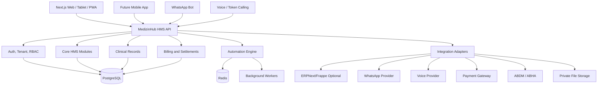

# Backend Architecture Spec

## Purpose

This spec defines the recommended backend architecture for MedizinHub HMS. It should guide the move from the current Next.js prototype into a production-ready plug-and-play healthcare SaaS platform.

## Recommended Backend Decision

Do not connect the frontend directly to ERPNext APIs.

Build a MedizinHub HMS backend API layer first. ERPNext/Frappe should be integrated later as an optional back-office adapter for accounting, inventory, HR, and finance workflows.

Recommended stack:

| Layer | Choice |
| --- | --- |
| Backend API | FastAPI or NestJS |
| Preferred for this product | FastAPI |
| Database | PostgreSQL |
| Cache and queues | Redis |
| Background jobs | Celery, Dramatiq, or RQ for FastAPI; BullMQ for Node/NestJS |
| Object storage | S3-compatible private storage |
| Search | PostgreSQL full-text first |
| Auth | Managed auth, Keycloak, or custom JWT/session with MFA |
| Observability | Structured logs, metrics, traces, audit logs |

FastAPI is a strong fit because MedizinHub HMS will likely need AI, automation bots, voice workflows, background jobs, and many integration adapters.

## System Context



## Modular Monolith First

Start as a modular monolith:

```text
backend/
  app/
    modules/
      identity/
      tenants/
      patients/
      appointments/
      queue/
      consultations/
      prescriptions/
      billing/
      settlements/
      lab/
      pharmacy/
      subscriptions/
      notifications/
      audit/
      integrations/
      settings/
    shared/
      database/
      auth/
      permissions/
      events/
      config/
      errors/
      security/
```

This keeps deployment simple while preserving future service boundaries.

## Core Backend Responsibilities

The backend owns:

- Tenant isolation.
- Authentication and authorization.
- Super admin, tenant admin, role, permission, and branch-scoped user management.
- Subscription plan enforcement.
- Patient master data.
- Appointment and queue state.
- Consultation records.
- Patient 360 read model.
- Billing and fee calculation.
- Doctor settlement.
- Audit logs.
- Consent records.
- Notification orchestration.
- External integrations.
- Secure file links.

The frontend owns:

- User experience.
- Fast interactions.
- Form state.
- Tablet/mobile layouts.
- Calling backend APIs.

ERPNext owns only optional back-office functions when enabled:

- Accounting.
- Inventory.
- Purchase.
- HR/payroll.
- Financial posting.

## Database Tenancy Model

Recommended default:

- Single PostgreSQL database.
- Shared tables.
- Every tenant-scoped table has `tenant_id`.
- Branch-scoped tables also have `branch_id`.
- Strict API-level tenant filtering.
- Add PostgreSQL row-level security later for high-risk tables if needed.

Enterprise option:

- Dedicated database or schema per enterprise tenant.

## Core Tables

Minimum foundation tables:

```text
tenants
branches
departments
users
roles
permissions
user_roles
subscription_plans
tenant_subscriptions
tenant_settings
patients
patient_contacts
patient_alerts
appointments
queue_entries
queue_events
consultations
consultation_versions
prescriptions
lab_orders
lab_results
invoices
invoice_items
payments
payment_allocations
doctor_fee_rules
doctor_settlements
consents
audit_events
notification_events
integration_connections
integration_sync_logs
files
```

## Authorization Model

Authorization is enforced in layers:

1. Authentication identifies the logged-in user through a short-lived bearer session.
2. Tenant context is resolved from `X-Tenant-ID` for tenant-scoped APIs.
3. Super admin bypass is allowed only for platform operations and audited tenant support access.
4. Tenant admin checks ensure a tenant admin can manage only their own tenant.
5. Module entitlement checks ensure the tenant subscription allows the feature.
6. Permission checks ensure the user's role allows the action.
7. Workflow guards validate state transitions such as queue requeue, consultation sign, payment refund, and invoice cancellation.

Recommended baseline permissions:

```text
platform.tenants.manage
platform.subscriptions.manage
identity.users.manage
identity.roles.manage
settings.manage
patients.read
patients.write
appointments.manage
queue.manage
consultations.write
consultations.sign
billing.manage
payments.manage
settlements.read
lab.manage
pharmacy.manage
notifications.manage
audit.read
reports.read
```

Role templates:

| Role | Scope | Typical permissions |
| --- | --- | --- |
| Super Admin | Platform | All tenants and platform setup |
| Tenant Admin | Tenant | Users, roles, settings, branch setup, reports |
| Doctor | Tenant/branch | Patient 360 read, consultation write/sign, lab/scan referral |
| Reception | Branch | Patient create/search, appointment, queue, communication trigger |
| Lab Technician | Branch | Lab order tracking and result upload |
| Pharmacy User | Branch | Prescription view, medicine issue, pharmacy billing |
| Billing Staff | Branch | Invoice, payment, refund guardrails |
| Back Office | Tenant/branch | Reports, settlement, operational support |

Global template lock policy:

- Roles and departments created under the primary `MedizinHub HMS` tenant can act as global templates.
- Super Admin can promote a reusable role, department, or branch from any customer tenant, for example MedizinHub Demo Clinic, into the primary tenant as a global template. Super Admin can also copy a reusable role, department, or branch from one tenant directly to another tenant.
- Role assignment uses the role key as the uniqueness rule inside the target tenant. If the target tenant already has that key, the assignment updates the existing role and permissions instead of creating a duplicate.
- The platform `super_admin` role is restricted to the primary `MedizinHub HMS` tenant and must not be copied into customer tenants.
- The primary `MedizinHub HMS` tenant should also maintain a reusable `tenant_admin` global role template. This template can be copied to customer tenants, but it must contain only tenant-scoped permissions and must exclude `platform.*` permissions.
- Branches created under the primary `MedizinHub HMS` tenant can also act as global branch templates. Branch template assignment uses branch code as the uniqueness rule inside the target tenant to avoid duplicate branch names and redundant setup data.
- When Super Admin assigns a global role, department, or branch to a customer tenant, the assigned record stores the source template id and is marked locked.
- Customer tenant admins can view and use locked global roles/departments/branches where applicable, but cannot edit, deactivate, delete, or alter role permissions on those locked records.
- Customer tenant admins can still create and manage their own local tenant roles, departments, and branches inside their tenant.
- Only MedizinHub HMS Super Admin can update the primary global template and reassign it to customer tenants.

Tenant clinical and revenue APIs now enforce module entitlement plus permission checks at API level. Appointment booking requires the appointments module and `appointments.manage`; queue actions require the queue module and `queue.manage`; consultation signing requires the consultations module and `consultations.sign`; billing/payment workflows require billing entitlements plus billing/payment permissions. Branch-scoped users are restricted to their assigned branch on branch-specific records and queries.

Inactive roles no longer grant permissions, and suspended tenants are blocked for tenant users on protected tenant APIs.

## API Design Rules

Use REST APIs first. Add GraphQL only if frontend complexity demands it later.

Resource APIs:

```text
GET/POST /patients
GET/PATCH /patients/{patient_id}
GET /patients/{patient_id}/timeline
GET /patients/{patient_id}/summary

GET/POST /appointments
GET/PATCH /appointments/{appointment_id}

GET /queue
POST /queue/{entry_id}/call
POST /queue/{entry_id}/mark-not-available
POST /queue/{entry_id}/requeue

GET/POST /consultations
POST /consultations/{consultation_id}/sign
POST /consultations/{consultation_id}/addendum

GET/POST /invoices
POST /invoices/{invoice_id}/collect-payment

GET/POST /settings
GET /audit-events
```

Command APIs should enforce workflow transitions. Do not let clients freely patch important statuses without validation.

## Workflow State Machines

### Appointment Status

```text
Scheduled -> Confirmed -> Checked In -> Waiting -> Called -> In Consultation -> Consultation Completed -> Billed
```

Alternative paths:

```text
Scheduled -> Cancelled
Waiting -> Patient Not Available -> Requeued -> Waiting
Patient Not Available -> No Show
Called -> Emergency Override
Consultation Completed -> Lab / Pharmacy / Follow-up / Admission
```

### Consultation Status

```text
Draft -> In Progress -> Signed -> Addendum Added
```

Signed records are read-only.

### Invoice Status

```text
Draft -> Issued -> Partially Paid -> Paid
Issued -> Cancelled
Paid/Partially Paid -> Refunded
```

Payment methods should support cash, credit card, debit card, UPI, GPay, Paytm, bank transfer, and mixed partial payments.

Revenue-grade billing now includes tenant/branch tax rules, approved discount requests, receipt PDF generation, credit notes, refund audit events, due collection reporting, branch/doctor/department revenue reporting, and finalized doctor settlement records.

## Patient 360 Backend Model

Patient 360 should be a read model built from:

- Patient profile.
- Alerts.
- Allergies.
- Chronic conditions.
- Consultations.
- Prescriptions.
- Lab results.
- Admissions.
- Procedures.
- Follow-up plans.

The read model can start as live database queries. Later, create a materialized summary table updated by events:

```text
patient_360_summaries
patient_360_events
```

AI summaries should be stored separately with metadata:

```text
ai_summaries
  tenant_id
  patient_id
  summary_type
  source_record_ids
  generated_by_model
  reviewed_by_user_id
  status
```

## Permissions

Every API request must resolve:

- User ID.
- Tenant ID.
- Branch scope.
- Role.
- Permissions.
- Subscription plan.

Permission checks should answer:

- Can this user access this tenant?
- Can this user access this branch?
- Can this user perform this action?
- Can this user view this patient record for the requested purpose?
- Is this module enabled for the tenant's plan?
- Does the action exceed plan limits?

## Audit Architecture

Audit logs should be append-only.

Audit event shape:

```json
{
  "tenant_id": "tenant_123",
  "branch_id": "branch_123",
  "actor_user_id": "user_123",
  "actor_role": "Doctor",
  "action": "patient.record.viewed",
  "resource_type": "patient",
  "resource_id": "patient_123",
  "purpose": "treatment",
  "metadata": {},
  "ip_address": "masked-or-stored-securely",
  "user_agent": "browser",
  "created_at": "2026-04-28T10:00:00Z"
}
```

Do not allow normal users to edit audit events.

## Settings Architecture

Settings should be stored with scope:

```text
settings
  tenant_id
  scope_type: platform | tenant | branch | department | practitioner
  scope_id
  key
  value_json
```

Examples:

- Queue requeue after N patients.
- Emergency priority enabled.
- Follow-up validity days.
- Voice token language.
- Invoice prefix.
- Doctor consultation fee.
- Doctor revenue split.

## Subscription Enforcement

Use a central entitlement service/helper:

```text
can_use_module(tenant_id, module_key)
check_limit(tenant_id, limit_key, requested_count)
consume_usage(tenant_id, usage_key, amount)
```

Enforce subscription at API level, not only in UI.

## Event and Worker Model

Use an outbox pattern:

```text
domain_events
  id
  tenant_id
  event_type
  payload_json
  status
  retry_count
  created_at
  processed_at
```

Important events:

- `appointment.booked`
- `appointment.cancelled`
- `queue.token_called`
- `queue.patient_requeued`
- `consultation.signed`
- `invoice.issued`
- `payment.received`
- `lab.result_ready`
- `followup.due`
- `patient.record_viewed`

Workers handle:

- WhatsApp notifications.
- Voice calls.
- Payment reminders.
- AI summaries.
- ERPNext sync.
- Report generation.

## ERPNext Integration Approach

ERPNext should be behind an adapter:

```text
MedizinHub HMS Billing Event
  -> Integration Adapter
  -> ERPNext Sales Invoice / Payment Entry
```

Recommended sync direction:

- MedizinHub HMS creates clinical and billing workflow.
- ERPNext receives accounting/inventory postings.
- Sync status is visible in admin.
- Failures are retried and do not block doctor consultation.

Do not make ERPNext DocTypes the primary data model for appointment, queue, consultation, or Patient 360.

## Security Requirements

Backend must provide:

- Password hashing or secure managed auth.
- MFA for privileged users.
- JWT/session validation.
- Tenant isolation.
- Rate limiting.
- Input validation.
- File upload validation.
- Secure signed URLs.
- Encryption for backups and object storage.
- Secrets through environment/secret manager.
- Structured security logs.

## Testing Requirements

Prioritize tests for:

- Tenant isolation.
- Role permissions.
- Patient history read-only behavior.
- Signed consultation immutability.
- Emergency queue priority.
- Requeue/no-show logic.
- Fee calculation.
- Doctor settlement calculation.
- Subscription limits.
- Audit logging.
- Secure link generation.

## Implementation Milestones

### Milestone 1: Backend Foundation

- FastAPI/NestJS project scaffold.
- PostgreSQL connection.
- Auth model.
- Tenant/branch/role tables.
- Subscription plan tables.
- Audit event table.

### Milestone 2: Clinic Core

- Patient APIs.
- Appointment APIs.
- Queue APIs.
- Emergency/requeue/no-show rules.
- Basic settings engine.

### Milestone 3: Clinical Core

- Consultation APIs.
- Prescription APIs.
- Signed record immutability.
- Patient 360 summary.
- Clinical access audit.

### Milestone 4: Revenue Core

- Fee rules.
- Invoice APIs.
- Payment recording.
- Doctor settlement.
- Owner revenue reports.

### Milestone 5: Automation and Integrations

- Notification events.
- WhatsApp adapter.
- Voice token adapter.
- Secure patient links.
- ERPNext adapter.
- AI summary service.
