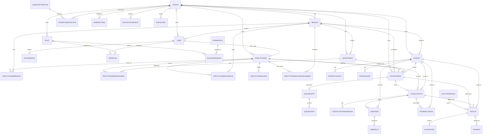

# MedizinHub HMS Database Design, ERD, and Production Gaps

## Purpose

This document is a development handover reference for the current MedizinHub HMS backend database design. It describes the implemented schema, major relationships, tenant isolation rules, module boundaries, and the missing production pieces that must be completed before a production SaaS rollout.

The current implementation uses FastAPI, SQLModel, and SQLite for local development. The production target should use PostgreSQL with Alembic migrations.

## Design Principles

- Every business record must be tenant-scoped using `tenant_id`.
- Branch-specific records must also carry `branch_id`.
- Clinical records must be append-safe. Signed consultations should not be edited directly.
- Appointment booking must not collect consultation fees.
- Consultation fee calculation happens later during billing, using appointment type, doctor, department, branch, and treatment type.
- Role and subscription checks must be enforced at API level, not only in frontend navigation.
- Patient history views and sensitive workflow changes must create audit events.
- External referrals, direct OP lab tests, and external prescriptions must be supported without forcing an appointment.

## Current Table Catalog

| Module | Tables | Purpose |
| --- | --- | --- |
| Tenant | `tenant`, `branch`, `department` | SaaS tenant, branch, and department/specialty structure |
| Identity | `user`, `role`, `permission`, `userrole`, `rolepermission`, `authsession` | Login, RBAC, sessions, application user type classification |
| Practitioner | `practitioner`, `practitionerbranch`, `practitionerdepartment` | Practitioner master, optional login user linkage, branch assignment, department/specialty mapping |
| Subscription | `subscriptionplan`, `tenantsubscription` | SaaS plan, trial, module entitlements, usage limits |
| Patient | `patient`, `patientcontact`, `patientalert` | Patient master, contacts, allergies/alerts |
| Appointment | `appointment` | OP/walk-in/online/home/emergency booking with timed practitioner availability checks |
| Queue | `queueentry`, `queueevent` | Token queue, call/requeue/no-show transitions |
| Consultation | `consultation`, `consultationaddendum`, `consultationvital`, `consultationcomplaint`, `consultationdiagnosis`, `consultationmedicine`, `consultationreferral`, `clinicaltemplate` | Structured doctor consultation, immutable signed records, addendums, department templates |
| Billing | `doctorfeerule`, `invoice`, `invoiceitem`, `payment` | Fee rules, invoice generation, payment/refund basics |
| Lab | `labtestcatalog`, `labtestpackage`, `labtestpackageitem`, `laborder`, `laborderitem`, `labsample`, `labresulttemplate`, `labresult` | Catalog, packages, doctor-referred/direct/external orders, sample tracking, templates, reports |
| Pharmacy | `medicinecatalog`, `pharmacysupplier`, `pharmacypurchase`, `pharmacypurchaseitem`, `medicinebatch`, `pharmacystockledger`, `pharmacyissue`, `pharmacyissueitem`, `pharmacyreturn`, `pharmacyreturnitem` | Medicine catalog, GST purchase, batch stock, expired return, stock ledger, prescription/direct issue, dispense |
| Settings | `adminsetting` | Tenant/branch settings such as invoice prefix and queue rules |
| Notifications | `notificationevent` | WhatsApp/SMS/voice notification queue |
| Audit | `auditevent` | Append-only audit trail |

## ERD



## Core Entity Notes

### Identity, Practitioner, and Patient Separation

MedizinHub HMS should not store application users, practitioners, and patients in one large user table.

Recommended production model:

- `user` is only for people who can log in to the application: MedizinHub super admin, tenant admin, reception, doctor login, lab, pharmacy, billing, nurse, back office, and support users.
- `user.user_type` classifies the login account for UI and workflow defaults, such as `platform_admin`, `tenant_admin`, `doctor`, `reception`, `lab`, `pharmacy`, `billing`, `nurse`, or `back_office`.
- `role` and `permission` remain the source of truth for access control. `user_type` must not replace RBAC permissions.
- `practitioner` stores clinical/provider profile data such as registration number, specialty, branch mapping, department mapping, schedule, leave, and room assignment.
- A doctor who logs in has both records: one `user` row for authentication/RBAC and one `practitioner` row linked through `practitioner.user_id`.
- A doctor who is only managed for appointment scheduling can exist as `practitioner` without a login `user`.
- `patient` stays separate because patient records are clinical/medical records, not staff login accounts.
- If patient mobile app or patient portal login is added later, create a separate patient-login link table or nullable `patient.user_id` style relationship only for portal authentication. Do not merge all patients into the staff `user` table.

This separation keeps RBAC clean, avoids exposing patient data through staff-login flows, supports doctors working across multiple departments, and allows patient identity/consent/clinical history to evolve independently.

### Tenant, Branch, Department

`tenant` represents a clinic company, hospital group, or SaaS customer. `branch` represents physical locations. `department` represents specialties such as general medicine, pediatrics, diabetology, ENT, and orthopedics.

The backend now includes a practitioner master foundation with branch mapping, department mapping, weekly schedules, leave blocks, and room assignments. This supports doctors and other care providers who work across multiple departments inside the same tenant, such as one doctor serving general consultation, pediatrics, and diabetology.

Current practitioner tables:

- `practitioner`
- `practitioner_department`
- `practitioner_branch`
- `practitioner_schedule`
- `practitioner_leave`
- `practitioner_room_assignment`

Current appointment behavior:

- Untimed appointments remain allowed for walk-in and legacy workflows.
- Timed non-emergency appointments validate practitioner branch/department assignment, active weekly schedule, slot interval, leave blocks, and same-time double booking.
- The calendar API generates frontend-ready available, booked, leave, and unavailable slots from the current schedule/leave/appointment state.
- Emergency appointments keep branch/department validation but can bypass schedule timing.

Recommended remaining production pieces:

- Dedicated appointment slot table for generated slot inventory and capacity.
- Practitioner leave approval workflow.
- Room inventory/master table with equipment and location metadata.

### Identity and RBAC

`user` stores login identity and optional tenant/branch assignment. `role`, `permission`, `userrole`, and `rolepermission` provide RBAC. `authsession` stores bearer-token sessions and supports logout/session revocation.

Current behavior:

- Super admin can access platform operations.
- Tenant users are restricted by tenant.
- Permissions are enforced by backend route dependencies.

Production gaps:

- Add unique indexes for email and tenant role key.
- Add branch/department/practitioner scoped permissions.
- Add permission version/session invalidation when roles change.
- Expand permission catalog from broad module permissions to action-level permissions such as `patients.view`, `patients.create`, `patients.edit`, `payments.refund`, `reports.export`.

### Subscription and Entitlements

`subscriptionplan` stores plan limits, enabled modules in `enabled_modules_json`, active/inactive state, and create/update metadata. `tenantsubscription` stores active, scheduled, expired, or cancelled plan/trial periods for each tenant, including billing amount, start/end dates, and create/update metadata.

`subscriptioncredit` stores add-on credits such as extra patient volume, quantity used, validity dates, amount, status, and audit metadata. `subscriptioninvoice` stores SaaS plan, renewal, upgrade, and credit purchase invoice records with issued, due, paid, and status fields.

Current plan checks enforce active subscription status, patient limits including active additional credits, and module entitlements such as `lab`, `pharmacy`, `voice`, `whatsapp`, `ai`, and `billing_advanced`. Scheduled subscriptions are automatically activated by the backend when their activation date is due.

Production gaps:

- Store enabled modules in a relational table instead of JSON if advanced reporting/filtering is needed.
- Add usage counters by month.
- Add payment gateway reconciliation and failed payment handling.
- Add formal credit consumption ledger if credits extend beyond patient limits into WhatsApp/SMS/AI usage.

### Patient Master

`patient` stores core demographics. `patientcontact` stores guardian/alternate contacts. `patientalert` stores allergies, chronic conditions, risk alerts, and notes.

Current behavior:

- Patient 360 view is audited.
- Important alerts/allergies are available to doctors.
- Patient records are tenant isolated.

Production gaps:

- Add patient merge table for duplicate patient handling.
- Add consent, privacy preferences, and data-sharing restrictions.
- Add ABHA/ABDM identifiers if ABDM integration is planned.
- Add structured vitals table.
- Add structured diagnosis/problem list table.

### Appointment and Queue

`appointment` captures patient, branch, department, doctor/practitioner id, visit type, visit purpose, source appointment for review/follow-up linkage, billable/free-review flag, billing note, date/time, status, reason, and emergency reason.

`queueentry` is generated from appointment and manages token number, priority, queue position, missed calls, called/completed timestamps. `queueevent` records transitions.

Important product rule:

- Appointment booking should not collect consultation fee.
- Appointment booking captures department, doctor, patient, visit type, visit purpose, billable/free-review flag, and token only.
- Doctor review and fitness certificate visits are tracked from appointment through consultation and invoice generation for audit, usage, and revenue reporting.
- Fee is calculated after consultation context is known.

Production gaps:

- Add unique token constraints per tenant/branch/date.
- Add appointment slot table.
- Add persisted/generated appointment slot inventory if capacity, overbooking, or analytics require materialized slots.
- Add cancellation/no-show reason catalog.
- Add online consultation session/link table.

### Consultation

`consultation` is one-to-one with appointment. It stores doctor notes, diagnosis, prescription text, lab referral text, scan referral text, follow-up advice, treatment type, status, and signed metadata.

`consultationaddendum` stores post-signing correction notes. Signed consultations must remain immutable.

Current fee context:

- `treatment_type` is stored on consultation.
- Billing uses appointment type, department, practitioner, branch, and treatment type to select fee rule.

Production gaps:

- Add structured prescription table.
- Add structured diagnosis/procedure coding.
- Add vitals capture.
- Add clinical document attachments.
- Add addendum approval workflow if required.
- Add doctor handoff/referral table.

### Billing and Payments

`doctorfeerule` defines consultation fees and doctor/clinic share. Matching supports branch, department, practitioner, appointment type, and treatment type.

`invoice` stores subtotal, discount, taxable amount, tax amount, totals, balance, doctor share, clinic share, and links to appointment/consultation, tax rule, and discount approval. `invoiceitem` stores line items. `payment` stores payment method, amount, status, reference number, and refund metadata.

`taxrule` stores tenant/branch GST or tax configuration. `discountapproval` stores requested discount, approval decision, and audit metadata. `creditnote` stores invoice-level credit/refund notes. `doctorsettlement` stores finalized settlement period, amount, and finalizing user.

Production gaps:

- Add invoice unique constraint per tenant and invoice number.
- Add payment allocation table for multi-invoice payments.
- Add ERPNext sync status fields.
- Add cancellation/reversal ledger.

### Lab

`labtestcatalog` stores reusable test definitions with code, name, department, sample type, default price, turnaround target, instructions, and active status. `labtestpackage` and `labtestpackageitem` group tests into reusable packages with package pricing.

`laborder` supports:

- Consultation referral
- Direct OP lab request
- External clinic referral

It tracks tests, source, status, priority, external referrer, amount, ordered user, and sample/result timestamps.

`laborderitem` stores the structured tests/packages selected for the order. `labsample` stores sample barcode, sample type, collector, collection time, and notes.

`labresulttemplate` stores reusable result-entry templates. `labresult` stores template reference, result summary, abnormal flag, report URL/file metadata, releasing user, and release time. Result release can queue report-ready notifications when provider settings and entitlements allow them. Consultation detail includes linked lab orders so doctors can see diagnostic status and result readiness.

IP admission stores optional `aadhaar_number` plus `admission_document_url`, `admission_document_name`, and upload timestamp for admission identity/proof files. Physiotherapy case stores `consent_files_json` for multiple consent-file metadata entries while preserving the latest file in `consent_form_url` and `consent_form_name` for backwards-compatible summaries.

Production gaps:

- Add report file storage table.
- Add lab device/integration adapter.
- Add doctor review/acknowledgement for abnormal results.

### Pharmacy

`medicinecatalog` stores medicine code, name, generic, form, strength, manufacturer, sale price, reorder level, and active status. `pharmacysupplier`, `pharmacypurchase`, and `pharmacypurchaseitem` capture supplier purchase workflow with purchase date, purchase order id, invoice number, line discount, header discount, taxable amount, CGST, SGST, GST total, and purchase totals.

`medicinebatch` tracks batch number, expiry, quantity on hand, cost, and sale price. `pharmacyreturn` and `pharmacyreturnitem` support expired or damaged medicine returns to suppliers with stock reduction and audit. `pharmacystockledger` stores purchase/dispense/return/adjustment movements with balance after each movement.

`pharmacyissue` supports:

- Doctor prescription from consultation
- Direct OP medicine issue
- External prescription issue

It tracks medicine text, source, external prescriber, amount, billing invoice link, dispense user, status, and cancellation reason. `pharmacyissueitem` stores structured medicine rows, batch, quantity, price, dispensed quantity, and substitute relationship.

Production gaps:

- Add controlled medicine restrictions if needed.

### Settings

`adminsetting` stores JSON settings by tenant or branch scope. Current keys include invoice prefix, payment methods, queue requeue rules, token language, follow-up validity, and communication providers.

Production gaps:

- Add department and practitioner scopes.
- Add setting versioning/history.
- Add schema validation per setting key.
- Add safe defaults per plan and tenant.

### Notifications

`notificationevent` queues WhatsApp, SMS, and voice notifications. Current implementation safely queues events without real provider integration.

Production gaps:

- Add background worker.
- Add retry policy.
- Add provider credentials table.
- Add template table.
- Add provider webhook delivery updates.
- Add DND/consent handling.

### Audit

`auditevent` records sensitive actions with actor, tenant, branch, action, resource type/id, purpose, metadata, and timestamp.

Production gaps:

- Make audit storage append-only at database/policy level.
- Add request id, IP address, user agent, and session id.
- Add before/after snapshots for settings, roles, and financial changes.
- Add export/audit review reports.

## Tenant Isolation Rules

Every API query that reads or mutates tenant data must include:

- Authenticated user
- Tenant context from `X-Tenant-ID` or super-admin context
- Tenant filter in DB query
- Branch validation where branch-specific

Rules:

- Super admin can switch tenant context but support access must be audited.
- Tenant admin can manage only their tenant.
- Staff users must not cross tenant boundaries.
- Patient history access by another doctor under the same tenant is read-only and audited.
- Signed consultations cannot be changed directly.

## Recommended Indexes and Constraints

The current SQLModel definitions add many single-column indexes. Production PostgreSQL should add composite indexes and unique constraints.

Recommended indexes:

| Table | Recommended Index |
| --- | --- |
| `patient` | `(tenant_id, patient_number)` unique |
| `patient` | `(tenant_id, mobile)` |
| `appointment` | `(tenant_id, branch_id, appointment_date, status)` |
| `appointment` | `(tenant_id, practitioner_id, appointment_date)` |
| `queueentry` | `(tenant_id, branch_id, status, priority_rank, queue_position)` |
| `queueentry` | `(tenant_id, branch_id, token_number, created_at)` |
| `consultation` | `(tenant_id, appointment_id)` unique |
| `consultation` | `(tenant_id, patient_id, created_at)` |
| `doctorfeerule` | `(tenant_id, branch_id, department_id, practitioner_id, appointment_type, treatment_type, is_active)` |
| `invoice` | `(tenant_id, invoice_number)` unique |
| `invoice` | `(tenant_id, patient_id, status)` |
| `payment` | `(tenant_id, invoice_id, status)` |
| `laborder` | `(tenant_id, branch_id, status, created_at)` |
| `laborder` | `(tenant_id, patient_id, created_at)` |
| `pharmacyissue` | `(tenant_id, branch_id, status, created_at)` |
| `notificationevent` | `(tenant_id, status, provider, created_at)` |
| `auditevent` | `(tenant_id, resource_type, resource_id, created_at)` |
| `adminsetting` | `(tenant_id, scope, scope_id, key)` unique |

Recommended constraints:

- `user.email` unique globally or unique per tenant depending on login policy.
- `role(tenant_id, key)` unique.
- `permission.key` unique.
- `branch(tenant_id, code)` unique.
- `department(tenant_id, branch_id, code)` unique.
- `appointment.department_id` must belong to same tenant.
- `invoice.consultation_id` unique when present.
- Financial amounts must be non-negative.

## Current Production Gaps

### Database and Migration

- Replace ad-hoc SQLite schema patching with Alembic migrations.
- Move production database to PostgreSQL.
- Add composite indexes and uniqueness constraints.
- Add migration tests.
- Add backup/restore process.
- Add seed strategy separated by local demo, staging demo, and production initial data.

### Practitioner and Department Design

Implemented backend foundation:

- Practitioner master
- Doctor-to-department many-to-many mapping
- Doctor-to-branch mapping
- Weekly doctor schedule/availability
- Doctor leave blocks
- Doctor room assignment
- Doctor fee overrides by branch/department/treatment

This is important because doctors can belong to multiple departments within one tenant. Remaining production work should add schedule recurrence exceptions, optional materialized slot inventory, room master metadata, and leave approval workflow.

### Clinical Data Structure

Current clinical data is mostly text-based. Production should add:

- Vitals
- Structured diagnosis/problem list
- Structured prescription
- Procedure records
- Attachments/documents
- Clinical templates
- Doctor referral/handoff records

### Lab and Pharmacy Depth

Current lab/pharmacy foundations are operational but not inventory-grade.

Missing:

- Lab test catalog and order item table
- Lab report file storage
- Barcode/sample tracking
- Medicine master
- Stock ledger
- Batch/expiry
- Purchase/vendor
- Pharmacy billing line-item integration

### ERPNext Integration

ERPNext should not replace MedizinHub HMS backend. MedizinHub should remain the source of truth for clinical and SaaS workflows. ERPNext should be integrated through an adapter/service layer for finance, accounting, and inventory.

Useful ERPNext features:

- Customer master for billable patients/tenants
- Item master for consultation, lab tests, medicines, procedures
- Sales Invoice for finalized invoices
- Payment Entry for payments
- Journal Entry for adjustments
- Chart of Accounts
- Cost Centers for branches/departments
- Employee records for doctors/staff references
- Payroll integration if needed
- Stock Item, Batch, Warehouse, Stock Ledger for pharmacy inventory
- Purchase Invoice and Supplier for pharmacy procurement
- GST/tax accounting workflows where configured
- Financial reports, receivables, P&L, balance sheet

Recommended integration pattern:

- Add `erpnext_sync_status`, `erpnext_document_type`, `erpnext_document_name`, `erpnext_last_synced_at`, and `erpnext_error` fields or a generic `integration_sync_event` table.
- Use async background sync, not direct blocking calls inside clinical workflows.
- Use idempotency keys for invoice/payment sync.
- Never let ERPNext own clinical records.

Recommended missing table:

```text
integration_sync_event
- id
- tenant_id
- branch_id
- provider
- local_resource_type
- local_resource_id
- external_doctype
- external_name
- status
- payload_json
- response_json
- error_message
- retry_count
- created_at
- updated_at
```

### Security and Compliance

Missing production controls:

- MFA for admin users.
- Password reset flow.
- Account lockout/rate limiting.
- IP/device/session visibility.
- Field-level encryption for sensitive data if required.
- Consent records.
- Data retention policy.
- Data export audit.
- PII masking in logs.
- Environment secret management.
- Security headers and production CORS policy.

### Audit Metadata Standard

Every business table should follow a common metadata contract:

```text
created_at
updated_at
created_by_user_id
updated_by_user_id
status or is_active
```

Every create/update/delete/status action must also write an `audit_event` row with:

```text
tenant_id
branch_id when applicable
actor_user_id
action
resource_type
resource_id
purpose
metadata_json when useful
created_at
```

Current implementation started this standard for tenant, branch, department, patient, appointment, queue, consultation, billing, notification, and identity workflows where APIs already write audit events. The remaining production hardening task is to apply the same metadata columns consistently across all legacy/foundation tables and require audit logging in every future module PR.

### Background Jobs

Missing worker system:

- Notification delivery
- Follow-up reminders
- Payment reminders
- ERPNext sync
- Report generation
- Lab report delivery
- Audit exports

Recommended stack:

- Celery/RQ/Arq worker
- Redis queue
- Scheduled jobs
- Dead-letter/retry table

### API and Frontend Handover

Needed before team handover:

- OpenAPI contract export.
- Endpoint-permission matrix.
- Postman/Bruno collection.
- Frontend component split from current single-page prototype.
- Environment file examples for backend/frontend.
- Developer setup verification script.
- Docker Compose for local PostgreSQL, Redis, API, and frontend.

## Recommended Next Implementation Order

This implementation order lists pending production work only.

1. Patient, appointment, and queue production rules: duplicate patient checks, duplicate slot prevention, follow-up handling, emergency override audit, Tamil/English token display/calling mode, and tablet reception flow.
2. Structured consultation tables: vitals, complaints, diagnosis rows, prescription items, lab/scan referrals, follow-up advice, clinical templates, signed record addendum.
3. Super Admin SaaS reporting: MRR, trials, usage limits, module adoption, failed payments, support access, and audit activity.
4. Multilingual and regionalization foundation: English/Tamil launch support, preferred language fields, tenant/branch language settings, language-aware notification templates, consent language/version tracking, and PAN India language-pack architecture.
5. Tablet/mobile/PWA hardening: responsive tables, compact navigation, touch-friendly controls, installable PWA, reception mode, and doctor tablet mode.
6. ERPNext adapter: `integration_sync_event` table, accounting sync, sales invoice sync, payment entry sync, inventory/purchase sync, and retry/error monitoring.
7. Production operations: backup/restore, deployment runbooks, secrets, observability, rate limits, indexes, load tests, CI, and compliance checklist.
