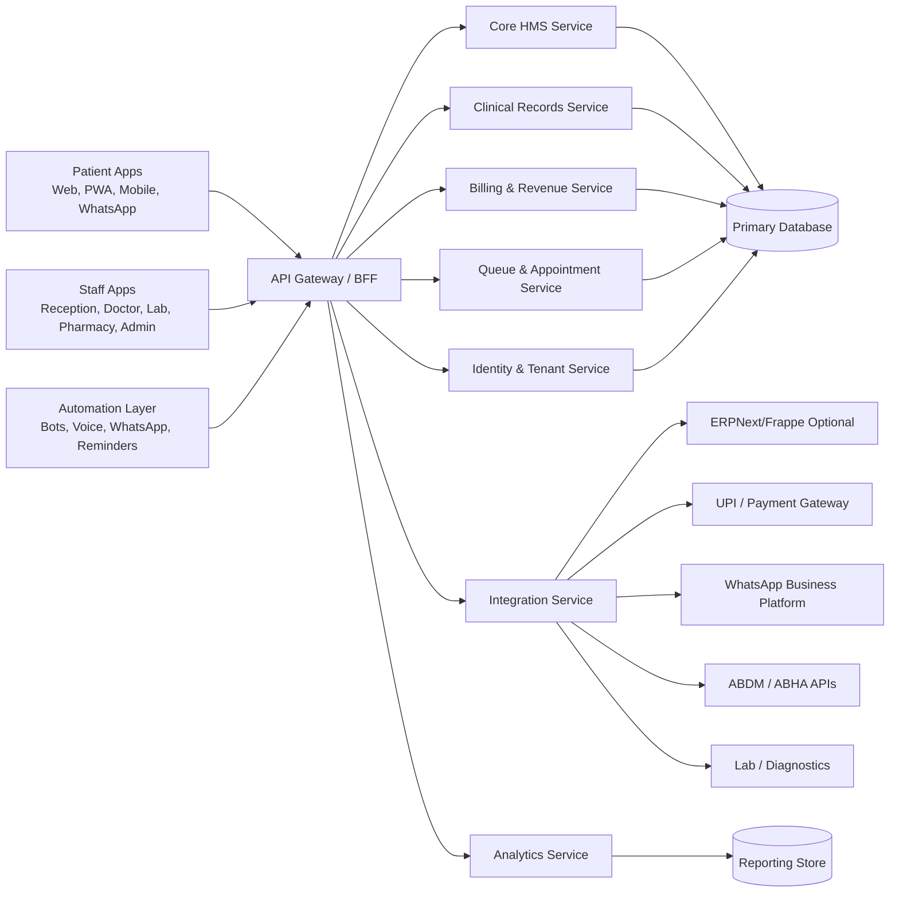

# Plug-and-Play Architecture

## Architecture Goal

MedizinHub HMS should be modular from day one. A small clinic should enable only appointments, patients, billing, and prescriptions. A larger hospital should add IP, lab, pharmacy, physiotherapy, multi-branch, analytics, ABDM readiness, and integrations without replacing the platform.

## Recommended High-Level Architecture



## Start Simple, Split Later

The current repository is a Next.js prototype. The first production stage can still be a modular monolith:

- One Next.js frontend.
- One backend API.
- One relational database.
- Clear module boundaries in code.
- Event table/outbox for async workflows.
- Background workers for reminders and automation.

Later, high-volume modules can split into services:

- Queue and appointment service
- Billing and revenue service
- Notification service
- Analytics service
- AI summarization service
- Integration service

## Module Boundary Rules

Each module should have:

- Own database tables or schema namespace.
- Own API routes.
- Own permissions.
- Own settings.
- Own audit events.
- Own enable/disable flag by subscription plan.

Modules should communicate through stable APIs and domain events, not direct UI shortcuts.

## Tenant Model

The platform should support:

- Tenant: healthcare company, clinic group, or hospital owner.
- Branch: physical clinic/hospital location.
- Department: specialty or service unit.
- Practitioner: doctor, physiotherapist, nurse, lab specialist.
- Patient: can belong to a tenant and optionally be shared across branches inside that tenant.

Recommended tenant hierarchy:

```text
SaaS Platform
  -> Tenant / Healthcare Company
      -> Branch
          -> Department
              -> Practitioner Schedule
      -> Shared Patient Master
      -> Tenant Settings
      -> Subscription Plan
```

## Plug-and-Play Configuration

Configuration should resolve in this order:

1. Platform default
2. Subscription plan
3. Tenant setting
4. Branch setting
5. Department setting
6. Doctor/practitioner override

Examples:

- Consultation fee default can be overridden by branch, department, doctor, and visit type.
- Queue rules can be defaulted at tenant level, then overridden by department.
- Follow-up validity can be tenant-wide, then customized for each specialty.

## Event-Driven Automation

Use domain events for automation:

- `appointment.booked`
- `appointment.checked_in`
- `queue.token_called`
- `queue.patient_not_available`
- `consultation.completed`
- `invoice.generated`
- `payment.received`
- `lab.report_ready`
- `followup.due`
- `patient.consent_granted`
- `patient.record_viewed`

Workers can subscribe to these events for:

- WhatsApp messages
- SMS
- Email
- Voice calls
- AI summaries
- Reports
- Owner alerts

## Integration Adapter Pattern

Every external service should use an adapter:

```text
Application Module -> Integration Port -> Provider Adapter -> External API
```

Example adapters:

- WhatsApp: Meta Cloud API, Gupshup, Interakt, Twilio
- Payment: Razorpay, Cashfree, PayU
- Voice: Exotel, Twilio, Knowlarity
- Accounting/Inventory: ERPNext/Frappe
- ABDM: approved ABDM gateway integration

This allows clinics to choose providers without changing core workflows.

## Optional ERPNext/Frappe Position

ERPNext/Frappe should be treated as an optional back-office engine, not the main user experience.

Use it for:

- Accounting
- Inventory
- Purchase
- HR/payroll
- Financial reports
- Advanced ERP workflows

Keep inside MedizinHub HMS:

- Appointment UX
- Doctor dashboard
- Patient 360
- Queue engine
- Automation logic
- SaaS subscription controls
- Patient-facing workflows

## Deployment Model

Recommended production setup:

- Frontend: Next.js hosted on Vercel, AWS, Azure, or equivalent.
- Backend/API: Node.js/NestJS or Next.js API initially.
- Database: PostgreSQL.
- Cache/queue: Redis.
- Object storage: S3-compatible storage.
- Workers: background worker service.
- Observability: logs, metrics, tracing, uptime checks.
- Region: prefer India region for Indian patient data.

## Non-Negotiable Platform Capabilities

- Tenant isolation.
- Role-based and purpose-based access control.
- Immutable signed clinical records.
- Audit trail for every patient record access.
- Subscription plan enforcement.
- Configurable modules.
- Secure external sharing through expiring links.
- Backup, restore, and disaster recovery.
